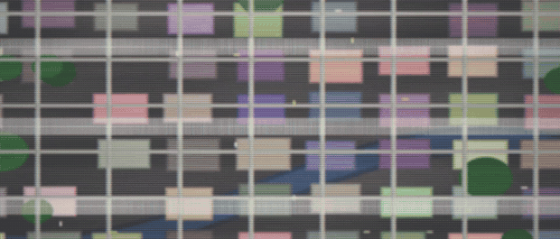
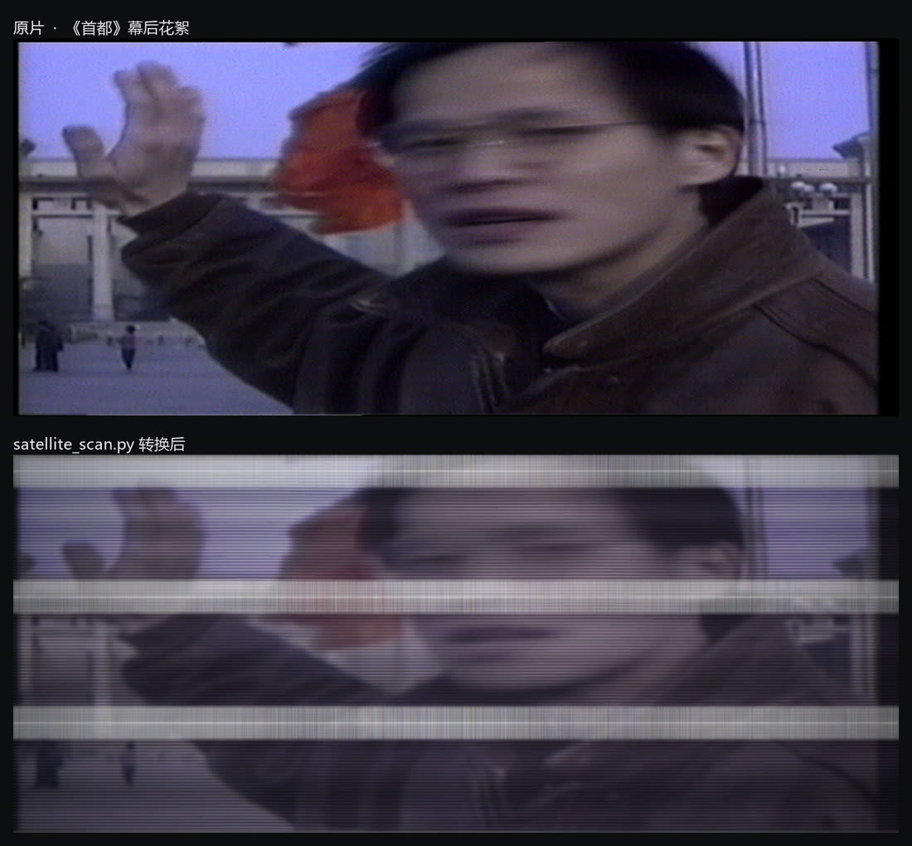
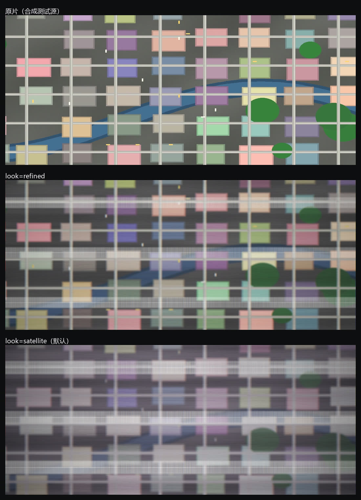
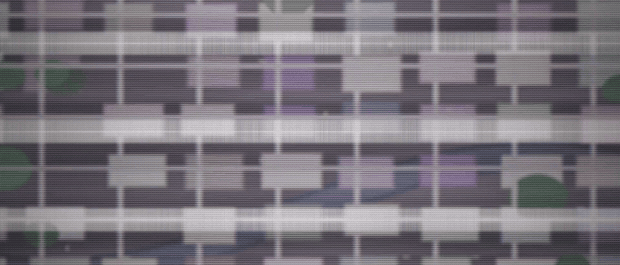

# satellite-scan

把普通视频转成**「人造卫星光学扫描」**的画面：一道白条自上而下扫过，配上逐行扫描光栅、行内横向拖影，可选把调色做成抬黑压白的紫灰监视器质感。

灵感来自罗大佑《首都》MV 里「但是人造卫星看得更真更早」那组镜头。



> 上图为合成测试源，`--look refined`（保留原片色彩）。默认的是 `satellite` 紫灰版，见下。

真实素材上的效果（《首都》幕后花絮，`--look satellite`）：



```
$ python satellite_scan.py input.mp4 -o output.mp4
```

**English** — A one-file CLI that turns any video into a satellite-scan look: a white scan
bar sweeping down the frame, a per-row raster with phase drift, horizontal smear from the
line-sensor integration, and an optional washed-out CRT grade. Requires `ffmpeg`, `numpy`
and `Pillow`. Output defaults to 1920×820 (2.34:1) at **3× speed**; pass `--speed 1` for
real time and `--look natural` to leave colours completely untouched.

---

## 从参考帧里量出来的参数

不是调出来的滤镜。先拿参考帧做量化分析 —— 扫描线间距、白条截面、亮度分布、色偏 ——
再让程序去复现这些数。用法：`python tools/analyze_ref.py ref.png`

| 特征 | 参考帧实测 | 程序做法 |
|---|---|---|
| 画幅 | 2.39–2.43 : 1（4:3 横向拉宽） | `--fit stretch`，默认 1920×820 |
| 白条根数 / 间隔 | 一屏 3 根，间隔 ≈ 0.32 画面高 | `bar_period=3`，周期 H/3，无缝循环 |
| 白条结构 | 一条细白线 + 一圈更淡更粗、**边缘明确**的边框 | `bar_core=0.0028` / `bar_fringe=0.050` |
| 白条走速 | ≈ 0.28 画面高/秒 | `bar_speed=0.68`（有意比参考帧快一倍，按输出时间算） |
| 扫描线间距 | ≈ 5.1 px @630 高 = 0.8% 画面高 | `pitch=0.0082` |
| 扫描线幅度 | 约亮度的 ±9–12% | `line_depth=0.26` |
| 扫描线横向相位 | 相隔 1100 px 时相关系数降到 0.05 | 沿 x 叠三个低频正弦做相位漂移 |
| 横/纵细节比 | dx/dy ≈ 0.11–0.13 | 颗粒先加、再横向 `avgblur` |
| 黑位 / 白位 | p1 ≈ 22、p99 ≈ 198 | `lift=0.075` / `white=0.76` 曲线 |
| 色偏 | R≈B > G，饱和度 0.19 | `tint` + `saturation=0.63` |

## 三种风格



| `--look` | 饱和度 | 黑位 | 白阶 | 拖影 | 颗粒 | 扫描线 | 白条 | 边框 | 暗角 |
|---|---|---|---|---|---|---|---|---|---|
| **`satellite`**（默认） | 0.63 | 0.075 | 0.76 | 7 px | 6 | 0.26 | 0.70 | 0.050 | 0.55 |
| `refined` | 0.88 | 0.033 | 0.94 | 5 px | 3 | 0.18 | 0.56 | 0.041 | 0.34 |
| `natural` | 1.00 | 0 | 1.00 | 3 px | 2 | 0.12 | 0.62 | 0.042 | 0 |
| `thermal` / `night` | 热成像 / 夜视色表 | | | | | | | | |

`natural` 会把调色、暗角、色差全部关掉，程序**整段跳过 `eq` / `curves`**，
输出与原片同色同反差，只多一层扫描。



## 安装

```bash
pip install -r requirements.txt     # numpy, pillow
# 另外需要 ffmpeg（含 libx264）。Windows 用 gyan.dev 的 full build 即可
```

Python 3.9+，单文件，无外部配置。

## 用法

```bash
# 整片（默认 3 倍速）
python satellite_scan.py input.mp4 -o output.mp4

# 原速
python satellite_scan.py input.mp4 -o output.mp4 --speed 1

# 只转 271.5 秒起 12 秒，并加卫星 HUD（角标/准星/坐标/高度/比例尺）
python satellite_scan.py in.mkv -o clip.mp4 --start 271.5 --duration 12 --hud full

# 先出一张静帧看效果（调参时最快）
python satellite_scan.py in.mp4 -o look.png --start 6 --still

# 保持原始宽高比，裁切填满
python satellite_scan.py in.mp4 -o out.mp4 --fit cover
```

输出带音轨：`.mkv` 用无损 FLAC，`.mp4` 用 AAC。

### 常用参数

| 参数 | 默认 | 说明 |
|---|---|---|
| `--width` / `--height` | 1920 / 820 | 输出尺寸 |
| `--aspect` | — | 用比例代替 `--height`，如 `2.34:1` |
| `--fit` | `stretch` | `stretch` 横向拉宽 / `cover` 裁切 / `pad` 黑边 |
| `--look` | `satellite` | 见上表 |
| `--intensity` | 1.0 | 整体强度，0 = 原片 |
| `--speed` | **3** | 输出倍速，1 = 原速 |
| `--bar-amp` | 0.70 | 白条峰值亮度，1.0 = 压成死白 |
| `--bar-speed` | 0.68 | 白条下移速度（**输出**画面高/秒，不随 `--speed` 变） |
| `--bar-period` | 3 | 一屏几根白条（整数才能无缝循环） |
| `--bar-fringe` | 0.050 | 白条外圈淡色边框的半宽，调大边框变粗 |
| `--bar-core` | 0.0028 | 白条本体（细亮线）半宽 |
| `--pitch` | 0.0082 | 扫描线间距（占画面高的比例） |
| `--line-depth` | 0.26 | 扫描线明暗幅度 |
| `--hblur` | 7 | 行内横向拖影半径（1920 宽下的像素） |
| `--grain` | 6 | 颗粒强度 0..100 |
| `--vignette` | 0.55 | 四角压暗 0..1 |
| `--hud` | `none` | `basic` / `full` 加卫星下传信息层 |
| `--crf` / `--preset` | 19 / veryfast | x264 质量与速度 |
| `--set KEY=VAL` | — | 覆盖任意内部参数，可重复 |

常用调法：

```bash
--bar-amp 0.9                     # 白条更狠
--bar-fringe 0.07                 # 边框更粗
--bar-period 1                    # 一屏只要一根大扫帚
--hblur 4 --grain 4               # 画面更清楚
--look natural                    # 颜色一点不动
--set line_depth=0 --set grain=0  # 连扫描线都不要
--set bar_luma_only=1             # 白条只提 Y 平面，色度完全不碰
```

## 三个实现要点

1. **白条不是高斯光晕，是「细白线 + 一圈平顶的粗边框」。** 边框用 `smoothstep` 收边，
   不是渐隐，所以看得见这条带从哪开始、到哪结束。做成对称高斯会变成一条"雾带"。
2. **颗粒必须在横向拖影之前加。** 线扫传感器一行一行扫，噪声也会被沿 x 拖成横丝；
   顺序反了横向细节降不下去（dx/dy 卡在 0.25，正确顺序能到 0.07）。
3. **变速放在处理链最后。** 先按 1× 把画面做完，再整体压时间轴；
   白条的 `scroll` 速率会先除以 `speed`，所以快进的只是内容，扫描束保持自己的节奏。

## 处理链

```
缩放 → [调色，中性时整段跳过] → 颗粒 → 横向 avgblur → 光栅(overlay) → 扫描线柔光(screen)
     → 白条扫描(screen, 向下滚动) → [走带亮带] → [四角压暗] → [色差] → [HUD]
     → setpts 变速
```

纹理用 numpy + Pillow 现算成 PNG，作为循环输入交给 ffmpeg 的 `scroll` 无级滚动
（按周期构造，滚到任何位置都无缝）。1920×820 / 24 线程下约 **1–6× 实时**。

`--dry-run` 会打印完整 ffmpeg 命令；`tools/profile.py` 可以逐级量每个滤镜的开销。

## 文件

```
satellite_scan.py            主程序（单文件）
assets/                      README 用的动图与对比图
tools/
  make_demo_source.py        生成纯合成的航拍城市测试源（无版权素材）
  analyze_ref.py             量一张参考帧的扫描特征
  metrics.py                 量一帧画面的亮度/色偏/各向异性等指标
  profile.py                 逐级跑滤镜，看每级开销
```

## 说明

- 演示用的合成素材由 `tools/make_demo_source.py` 程序化生成，不含任何第三方画面。
- `assets/example_real.jpg` 取自《首都》MV 的幕后花絮，仅作效果示例；
  版权归原权利人所有，如不需要可直接删除该文件及 README 中对应的一行。

## License

MIT
